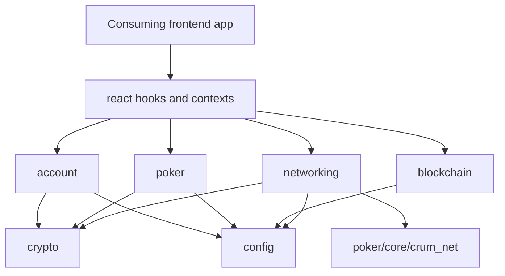
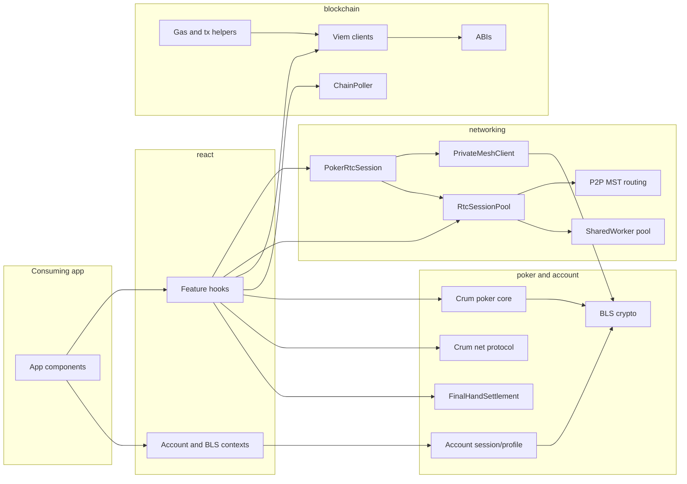
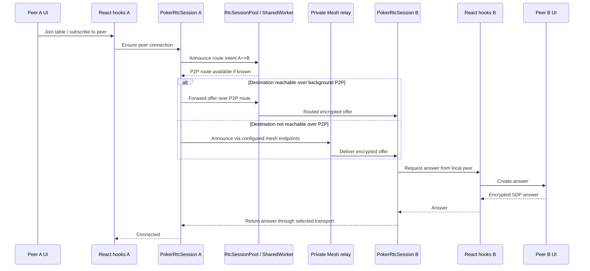
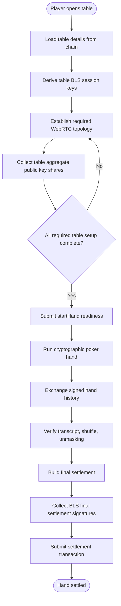
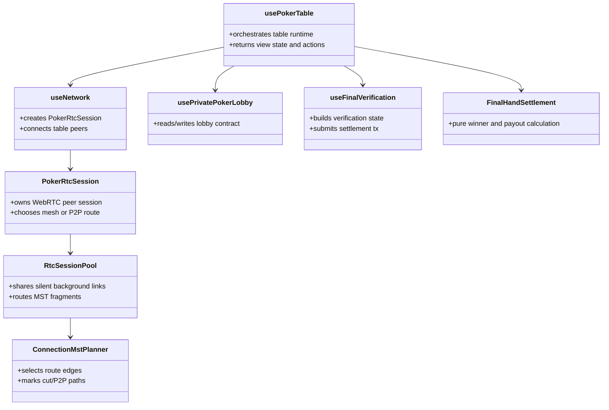

# PrivatePoker Hooks Architecture

`privatepoker-hooks` is the publishable backbone of Private Poker. It contains the reusable peer-to-peer networking, mesh signalling, blockchain access, cryptographic helpers, poker protocol code, and React orchestration hooks that a frontend can compose into an application.

The package deliberately does not contain the Private Poker product UI. A consuming app can create lobbies, join tables, establish WebRTC connections, exchange poker protocol messages, verify final hand state, and write settlement transactions, but the app owns visual presentation and user flow.

## Architectural Goals

- Keep reusable protocol machinery outside the frontend app.
- Make networking, blockchain, poker, account, config, and React adapter responsibilities visible in the folder structure.
- Keep pure domain logic independent from browser APIs, wallet APIs, and React.
- Keep React hooks thin enough that they orchestrate services rather than owning every detail.
- Publish stable public imports through `package.json` exports while retaining legacy compatibility paths.

## Top-Level Source Map

```text
src/
  account/       Wallet-derived account sessions and encrypted profile blobs.
  blockchain/    ABIs, viem clients, gas helpers, transaction logging, chain polling.
  config/        Dev/main environment selection, chain config, mesh endpoints, constants.
  crypto/        BLS12-381 primitives and signal encryption support.
  lobby/         Local browser lobby events shared by app components.
  networking/    WebRTC sessions, session pool, mesh relay, P2P route discovery.
  poker/         Poker domain logic, protocol state, settlement helpers.
  react/         Context providers and hooks for consuming frontends.
  shared/        Reserved home for general utilities that do not belong to a domain.
  shims/         Compatibility shims used outside Next.js.
  tests/         Node test coverage for settlement and P2P MST gossip/routing.
```

## Dependency Direction

The clean direction is from outer layers to inner layers:



Inner layers should not import React. Poker core should not import wallet clients, WebRTC, mesh servers, or browser storage. Blockchain modules should not know about UI components. This keeps the package useful as a library and makes future extraction into worker/runtime packages easier.

## Runtime Component View



## P2P Connection Sequence



## Table And Hand Activity



## Collaboration Diagram



## Documentation Index

- [Networking](./verticals/networking.md)
- [Blockchain](./verticals/blockchain.md)
- [Poker](./verticals/poker.md)
- [React Adapters](./verticals/react.md)
- [Configuration](./verticals/configuration.md)
- [Source Directory Map](./src/README.md)

## Current Refactor Boundary

The package is now organized by responsibility, but two runtime classes remain intentionally large:

- `src/networking/session/PokerRtcSession.js`
- `src/networking/pool/RtcSessionPool.js`

They are documented as facades for now. Future refactors should split them into smaller collaborators without changing their public contracts first.
