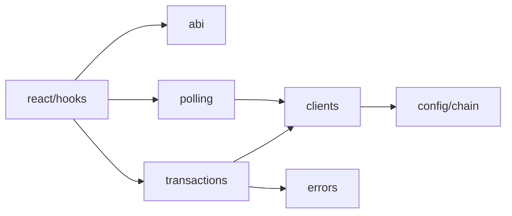

# `src/blockchain`

The blockchain directory contains all reusable chain-facing primitives: ABIs, viem clients, polling, gas estimation, operator transactions, receipt logging, and error formatting.

## Boundary

Blockchain modules may depend on viem and chain config. They should not depend on React components or poker UI state.
