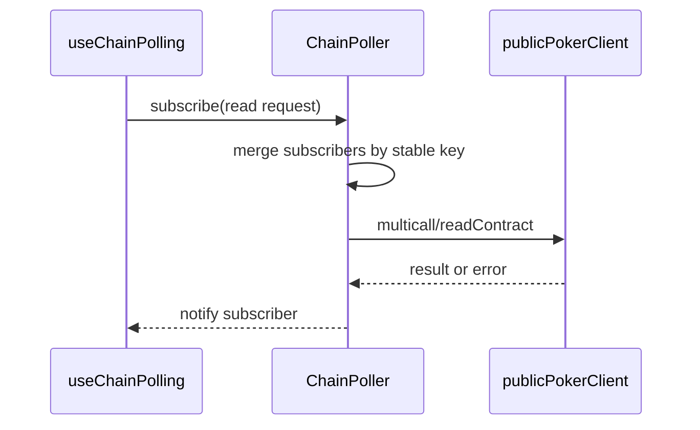

# `src/blockchain/polling`

This directory owns shared contract-read polling and batching.

## Files

- `ChainPoller.js`: subscription registry, stable request keys, due-window batching, viem multicall fallback, and subscriber notification.

## Boundary

Polling should not know about specific UI screens. Timing defaults live in `config/chain/polling.js`.
