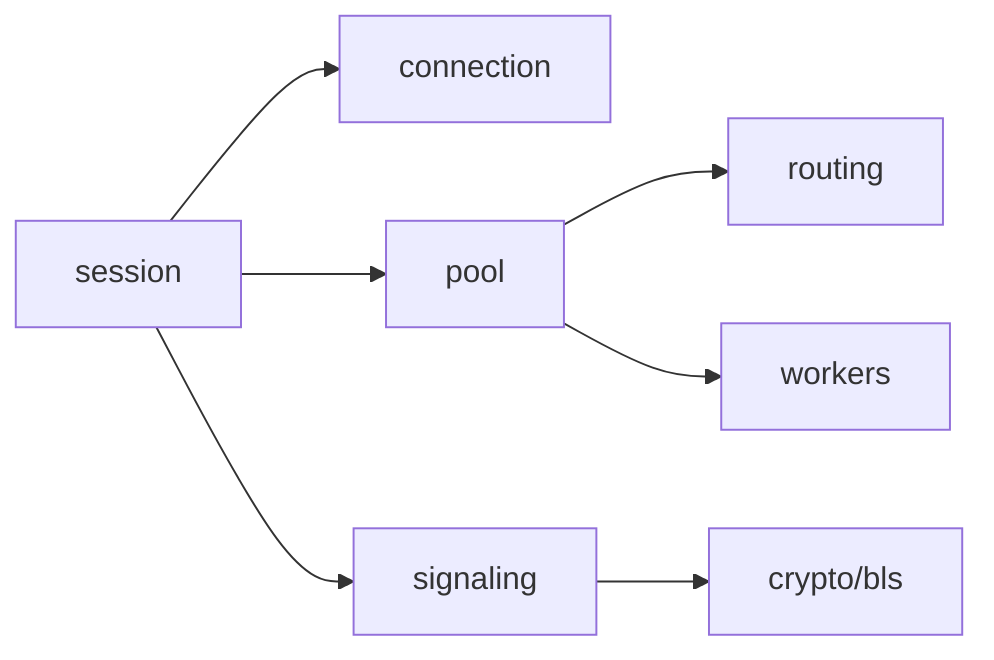

# `src/networking`

The networking directory owns WebRTC runtime behavior, connection establishment, private mesh signalling, route planning, and shared background connections.

## Children

- `connection`: connection establishment strategy interfaces and implementations.
- `pool`: browser-wide session pool facade.
- `routing`: pure route planning and P2P MST gossip.
- `session`: visible table peer session facade.
- `signaling`: private mesh client and encrypted signalling helpers.
- `workers`: SharedWorker implementation used by the pool.

## Boundary

Networking may depend on config, crypto, and poker network protocol types. It should not own poker game rules or React UI state.
