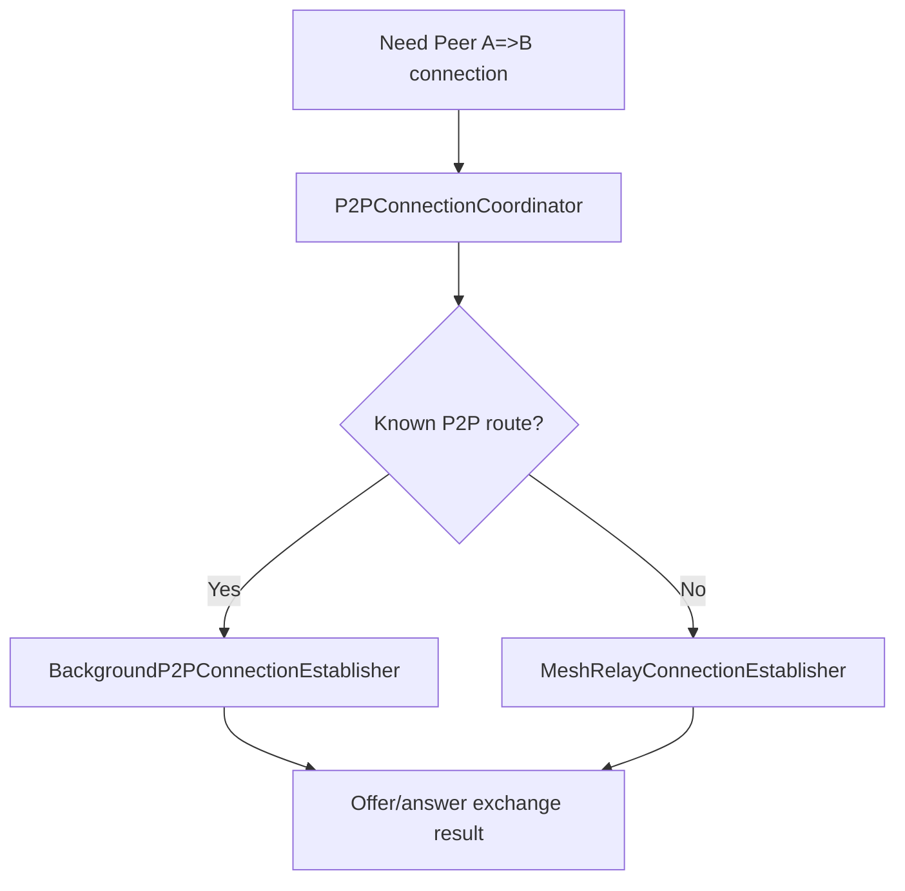

# `src/networking/connection/p2p_connection`

This directory contains the two connection-establishment implementations used by the WebRTC session layer.

## Files

- `BackgroundP2PConnectionEstablisher.js`: attempts to establish a connection through an already reachable background P2P route.
- `MeshRelayConnectionEstablisher.js`: establishes through the private mesh relay.
- `P2PConnectionCoordinator.js`: coordinates strategy selection.
- `index.js`: public barrel.

## Boundary

Strategy classes should remain reusable. They can call networking services, but should not own React state or poker table UI behavior.
