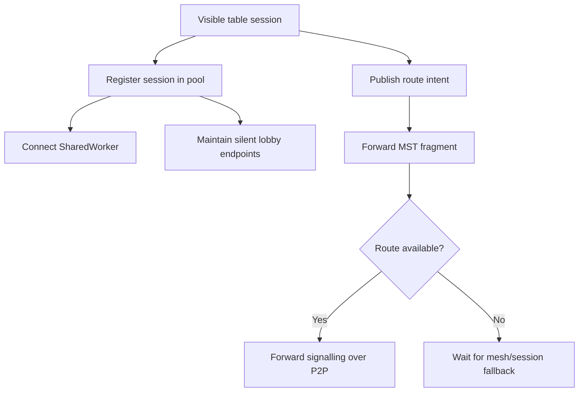

# `src/networking/pool`

This directory contains the shared browser-wide RTC session pool.

## Files

- `RtcSessionPool.js`: facade for silent lobby connections, local session lookup, BroadcastChannel/SharedWorker routing, route intent gossip, and background P2P forwarding.

## Activity

## Boundary

`RtcSessionPool` is currently a large facade. Future refactors should split worker bridge, route gossip, session registry, and silent connection lifecycle into collaborators without changing exported behavior.
