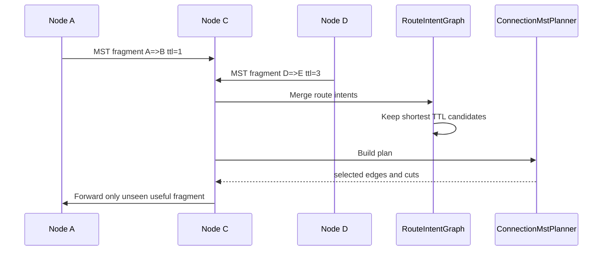

# `src/networking/routing/p2p_mst`

This directory implements P2P route-intent gossip and MST-style route planning.

## Files

- `ConnectionMstPlanner.js`: builds a plan that marks selected direct edges and cut/P2P routes.
- `RouteIntentGraph.js`: stores directional route intents, TTL distance, seen-neighbor metadata, and merge logic.
- `identity.js`: stable peer and edge ids.
- `constants.js`: message and route-state constants.
- `index.js`: public barrel.

## Route Collaboration

## Boundary

This package should remain independent from WebRTC and HTTP. Tests should cover complex graph convergence and stale intent expiry.
