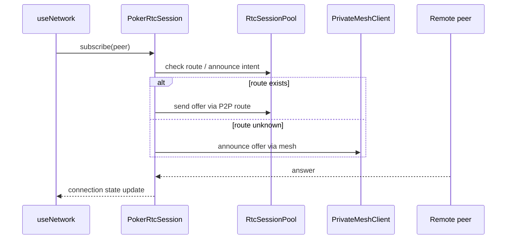

# `src/networking/session`

This directory contains the visible WebRTC table session facade.

## Files

- `PokerRtcSession.js`: manages per-table peer subscriptions, data channels, signed transport messages, encrypted signalling, mesh/P2P connection establishment, and media/data-channel state.

## Sequence

## Boundary

`PokerRtcSession` is intentionally documented as a facade today. Future collaborators should split signing, peer connection lifecycle, discovery, media, and signal codec responsibilities.
