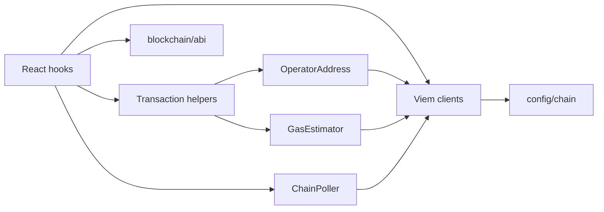
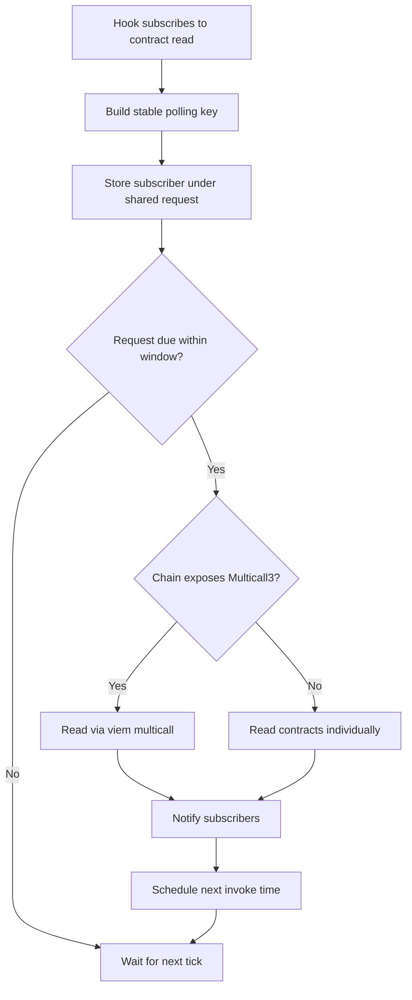
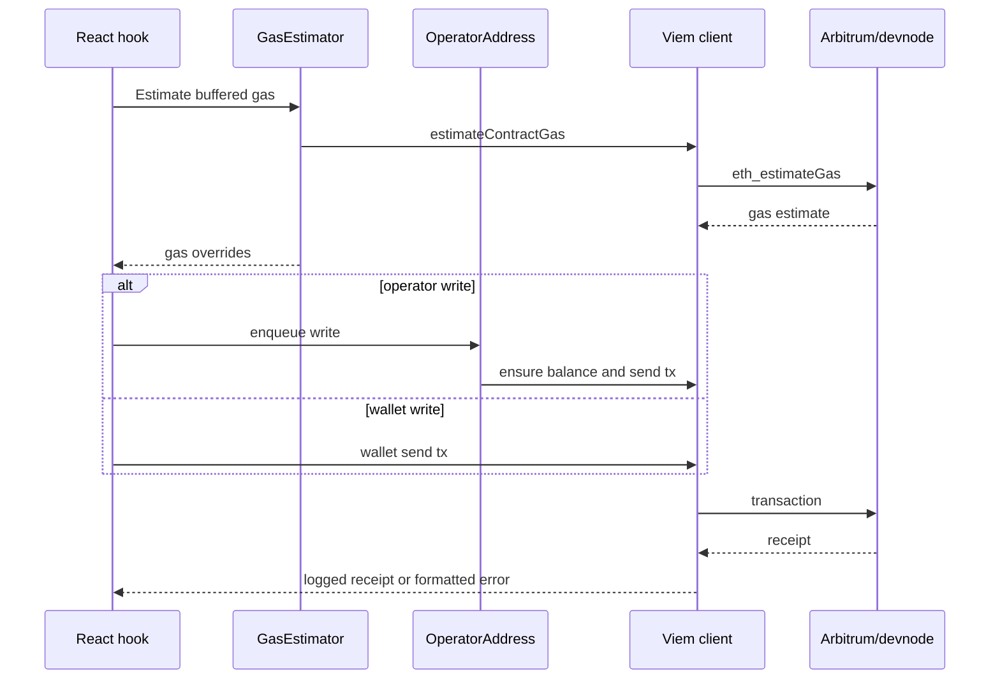

# Blockchain

The blockchain vertical wraps Arbitrum Sepolia or local devnode access. It owns contract interfaces, viem clients, polling aggregation, gas estimation, operator-address writes, transaction receipt logging, and user-facing chain error formatting.

## Responsibilities

- Define contract ABIs in one place.
- Create configured viem public and wallet clients.
- Aggregate repeated reads through `ChainPoller` and viem multicall batching.
- Estimate buffered gas for wallet/operator transactions.
- Serialize operator writes per operator address to avoid nonce collisions.
- Log transaction receipts and translate known chain failures into clearer messages.

## Component View

## Polling Activity

## Transaction Sequence

## Design Rules

- ABI files must not import React hooks.
- Chain environment selection belongs in `config/chain`, not in callers.
- Repeated reads should use `useChainPolling` or `ChainPoller`, not scattered intervals.
- Operator writes should go through `OperatorAddress` so nonce serialization remains central.
- Contract-specific decode helpers can stay near hooks while they are still UI-shaped, but mature decoders should move into blockchain or domain modules.
