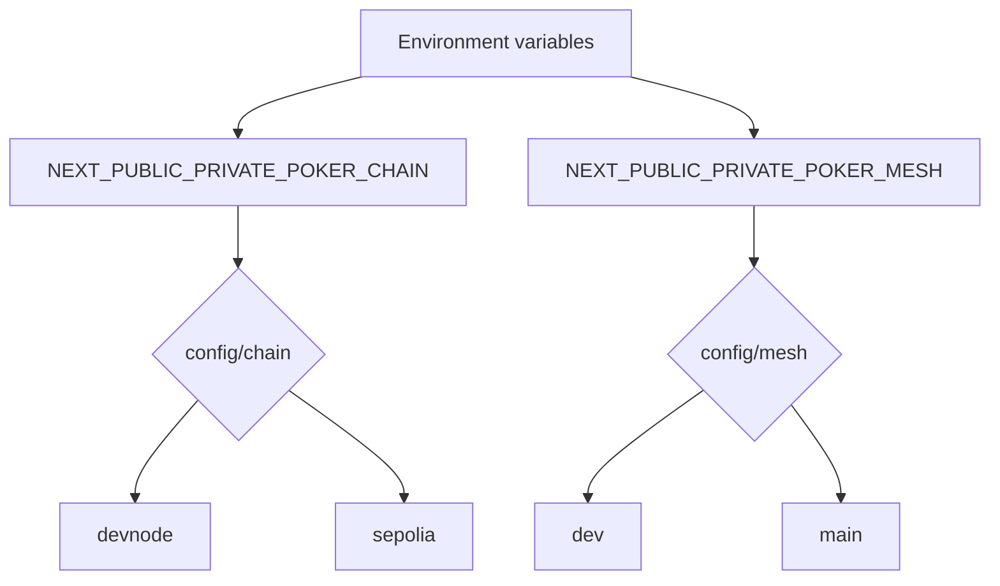
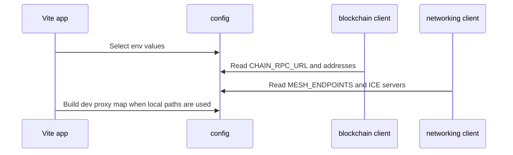

# Configuration

The configuration vertical controls which chain and mesh environment the package uses. Environment variables select named config objects; sensitive values should not be committed into configuration files.

## Responsibilities

- Select chain environment: `devnode` or `sepolia`.
- Select mesh environment: `dev` or `main`.
- Expose contract addresses, RPC URL, polling timings, stale time, and max-gas policy.
- Expose mesh endpoints and ICE server settings.
- Provide dev proxy rewriting for Vite.
- Centralize constants shared by account, chain, lobby, and poker logic.

## Environment Selection

## Runtime Config Use

## Design Rules

- Config modules export plain values and lightweight factory helpers.
- Secrets do not belong in committed config.
- Environment-specific objects live under `config/*/environments`.
- Derived selected constants live in `config/chain/index.js` and `config/mesh/index.js`.
- Polling defaults live in `config/chain/polling.js`, not inside the polling class.
