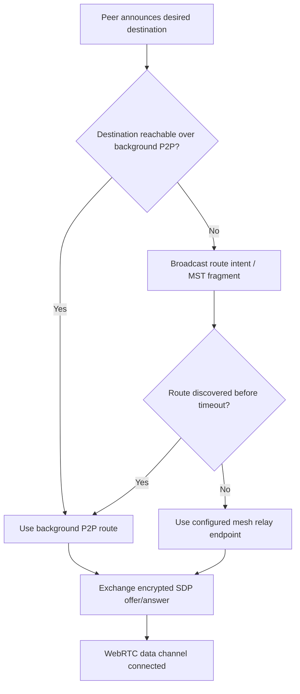
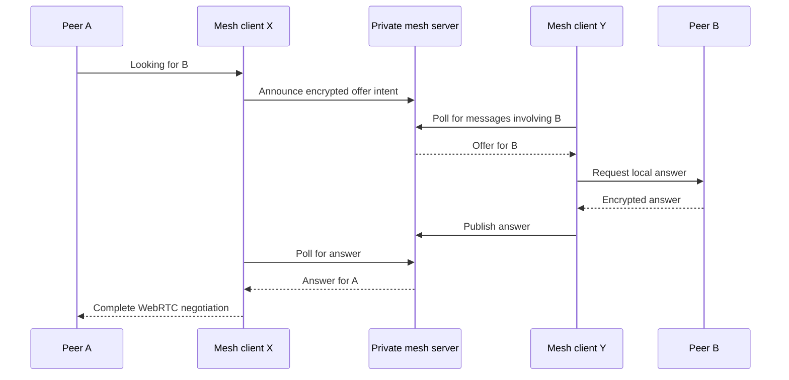
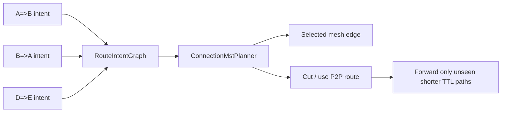

# Networking

The networking vertical owns WebRTC connection establishment, mesh relay fallback, silent background P2P routes, and MST-style route discovery. It is the backbone that lets a browser-only poker table operate even when players are connected to different mesh nodes.

## Responsibilities

- Create and maintain WebRTC peer connections.
- Encrypt and decrypt signalling payloads.
- Decide whether to route through background P2P or through configured mesh endpoints.
- Maintain a shared session pool across tabs through a `SharedWorker`.
- Gossip route intents and MST fragments so reachable peers can avoid unnecessary mesh relay usage.
- Surface connection state to React hooks without coupling lower layers to React.

## Main Modules

- `networking/session/PokerRtcSession.js`: per-table/per-peer WebRTC session facade.
- `networking/pool/RtcSessionPool.js`: browser-wide pool for background links and route gossip.
- `networking/connection/p2p_connection`: connection establishment strategies.
- `networking/routing/p2p_mst`: pure route-intent graph and MST planning logic.
- `networking/signaling/PrivateMeshClient.js`: HTTP long-poll client for private mesh relay.
- `networking/signaling/SignalEncryption.js`: encryption adapter around BLS signal crypto.
- `networking/workers/rtc-session-pool-worker.js`: SharedWorker event bus.

## Transport Selection

## Mesh Relay Sequence

## Background P2P Route Gossip

`RtcSessionPool` shares route knowledge between visible sessions, silent lobby sessions, local tabs, BroadcastChannel listeners, and the SharedWorker. The route graph stores directional connection intents such as `A=>B`, including flow id and TTL distance. `ConnectionMstPlanner` chooses which directions should be active mesh-style edges and which opposite directions should become P2P cuts.

## Design Rules

- Connection establishment strategies live behind a common coordinator.
- Signalling data must stay encrypted at transport boundaries.
- Route selection should prefer known P2P reachability and avoid mesh fallback when destination reachability is known.
- SharedWorker and BroadcastChannel logic belongs in the pool, not in React hooks.
- Route planning must stay pure and testable.

## Future Split Targets

`PokerRtcSession` should eventually split into:

- peer subscription store
- peer connection manager
- media manager
- transport signer
- encrypted signal codec
- discovery controller

`RtcSessionPool` should eventually split into:

- local session registry
- cross-tab bus
- worker bridge
- silent lobby endpoint
- P2P MST gossip router
- connection request queue
