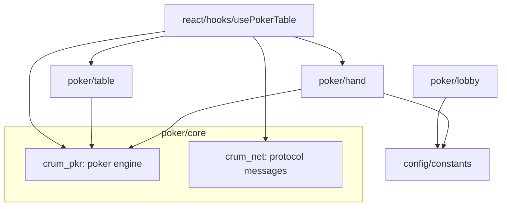
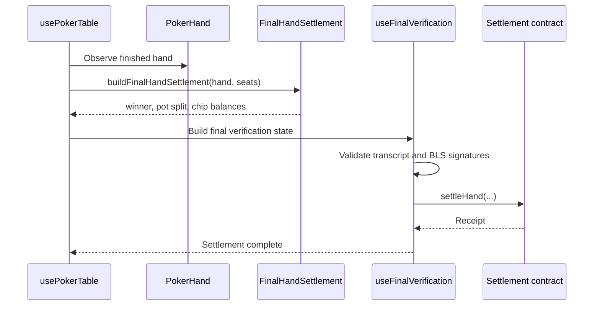
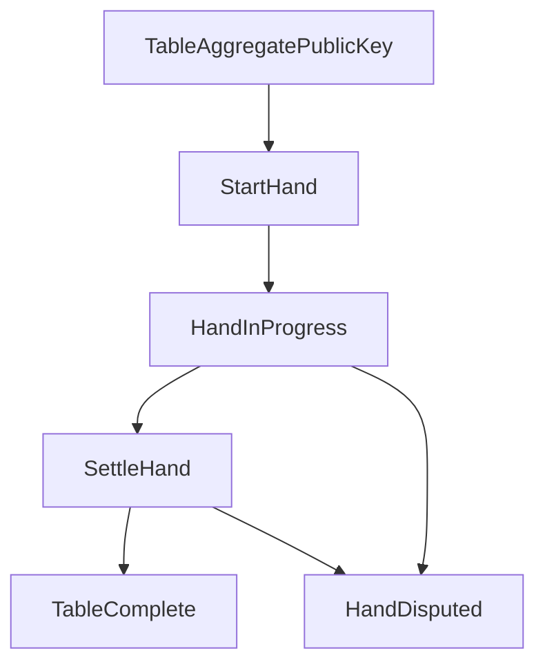

# Poker

The poker vertical contains domain and protocol code: cryptographic card state, betting state, table and hand transitions, network protocol envelopes, final hand settlement helpers, lobby stake helpers, and table protocol state.

## Responsibilities

- Model Texas Hold'em table and hand state.
- Represent masked/unmasked cards and shuffle/unmask verification bridges.
- Serialize poker network messages.
- Decide table protocol phase transitions.
- Compute final hand settlement payloads.
- Keep domain logic independent of React, browser APIs, wallets, and WebRTC.

## Component View

## Hand Settlement Sequence

## Protocol State Activity

## Design Rules

- `crum_pkr` is the poker engine. It should remain reusable outside the browser.
- `crum_net` is protocol-only. It can define envelopes and serialization, but should not own transports.
- Settlement calculation belongs in `poker/hand`.
- Table protocol state belongs in `poker/table`.
- React hooks may orchestrate poker, but should not become the long-term home for pure poker algorithms.
