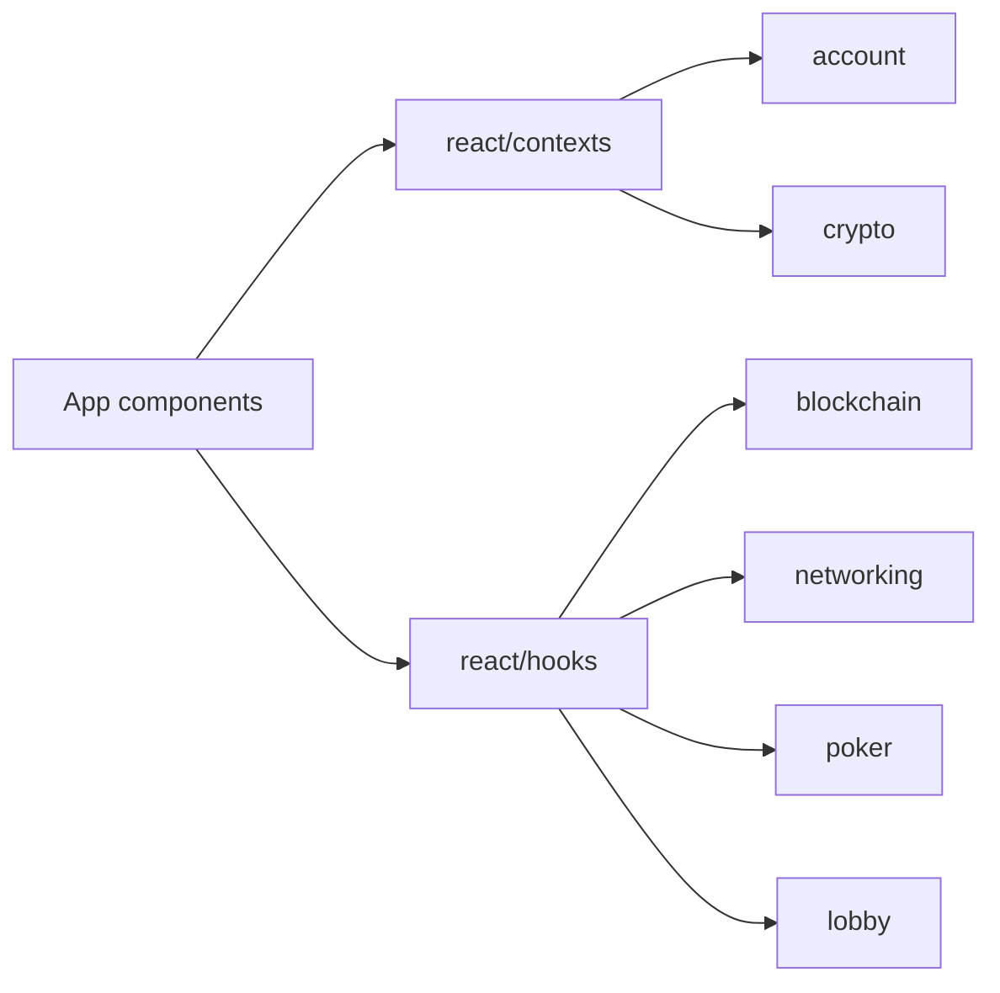
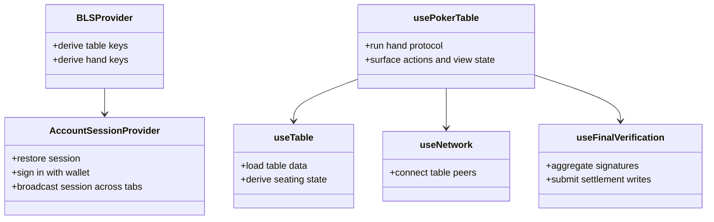

# React Adapters

The React vertical is the package's app-facing adapter layer. It exposes providers and hooks that combine account sessions, BLS key derivation, contract access, network sessions, and poker runtime state.

## Responsibilities

- Provide account session and BLS context state.
- Expose feature hooks for lobbies, tables, accounts, Chips, network, and final verification.
- Convert low-level domain events into ergonomic view state and actions.
- Keep UI components in the consuming app, not in the package.

## Component View

## Hook Collaboration

## Design Rules

- Hooks are allowed to import React, wagmi, browser APIs, and package services.
- Domain code must not import hooks.
- Prefer hooks returning stable state/actions over hooks exposing lower-level mutable objects.
- Keep view-model formatting close to hooks until it becomes reusable across multiple apps.
- Move pure helpers out of hooks as soon as they are tested and independently meaningful.
